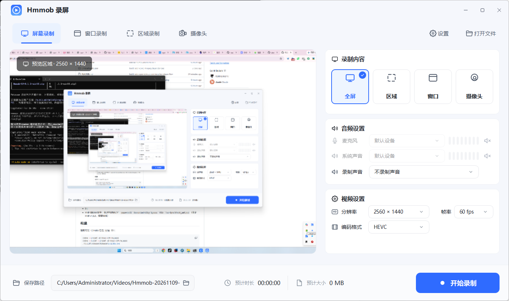
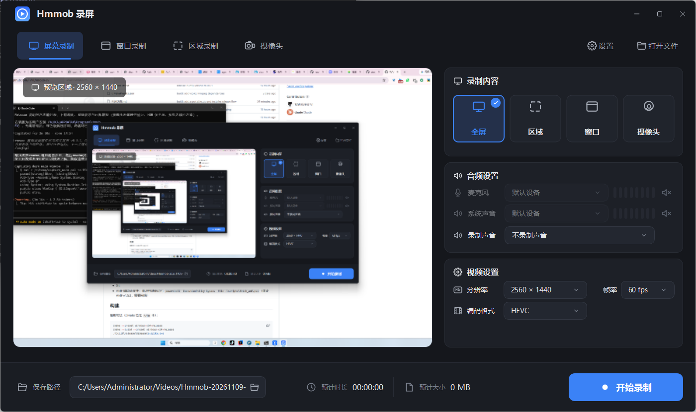
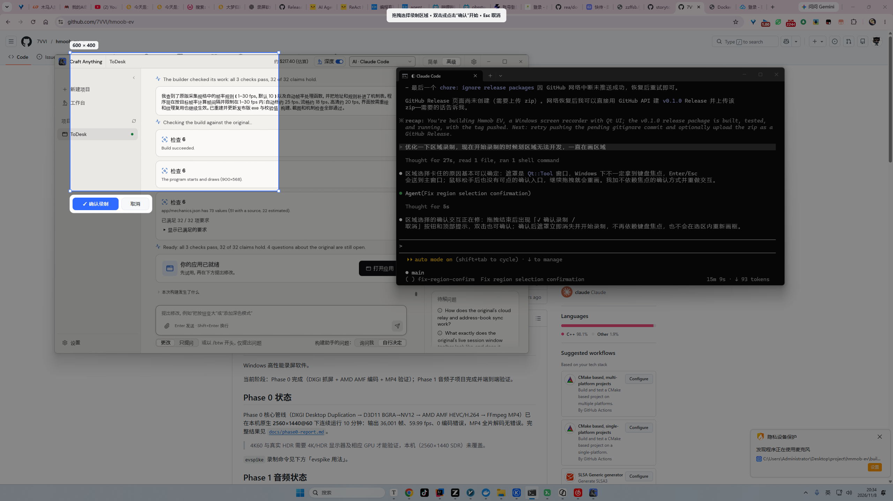
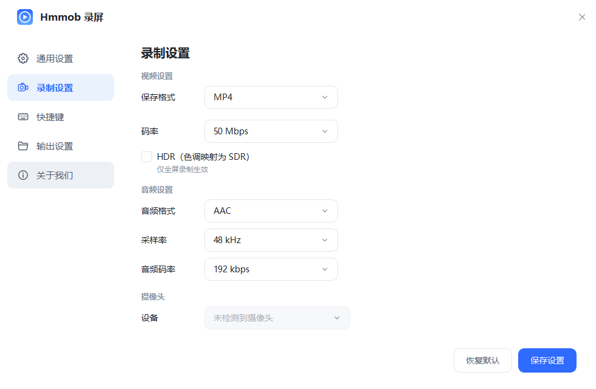
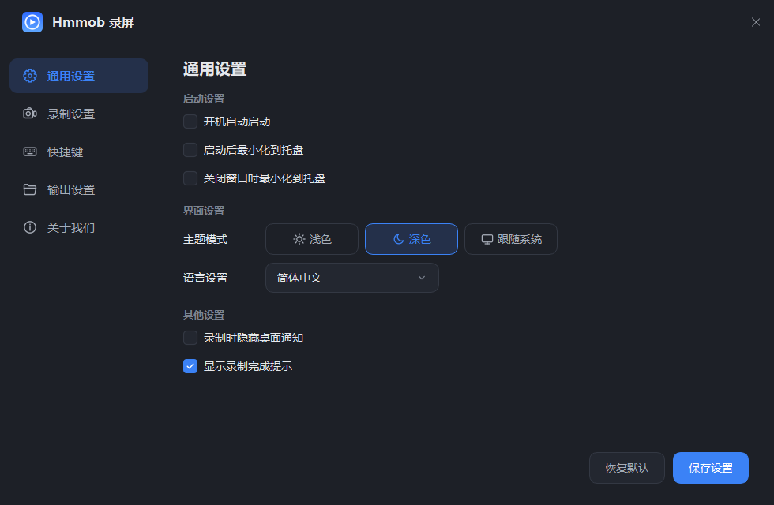
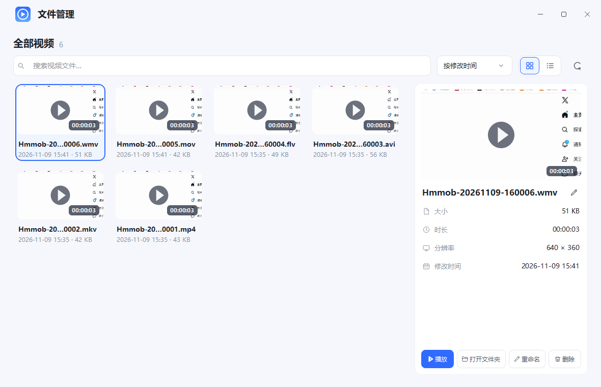
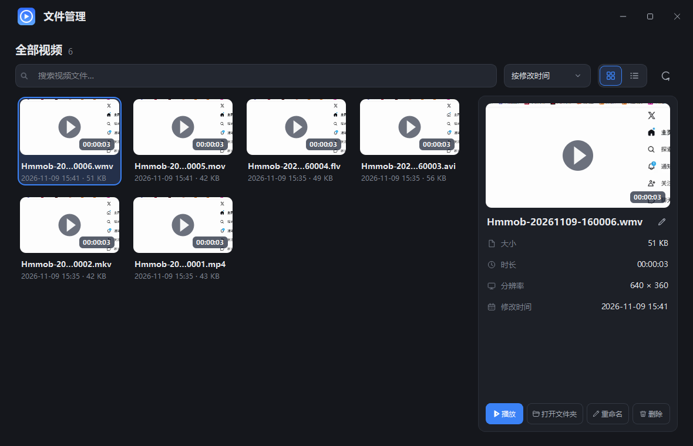

# Hmmob EV 录屏


Windows 高性能录屏软件。基于 DXGI Desktop Duplication 与 Windows Graphics Capture 采集，D3D11 零拷贝转换，AMD AMF 硬件编码，FFmpeg 封装，WASAPI 采集音频。



## 功能特性

- **四种录制模式**：全屏、区域（拖拽框选）、窗口（Windows Graphics Capture）、摄像头（Media Foundation）
- **硬件编码**：HEVC / H.264（AMD AMF），GPU 内 BGRA → NV12，无 CPU 回读
- **多种容器**：MP4 / MOV / MKV / AVI / FLV / WMV（自动校验编码与容器兼容性）
- **音频**：系统声音 + 麦克风混音，可选仅麦克风、仅系统声音或静音；真实设备选择；AAC / PCM；44.1 / 48 kHz；96–320 kbps
- **实时预览**、录制统计、录制倒计时（0/3/5/10 秒）
- **应用内文件管理**：缩略图网格、搜索/排序、详情、播放、打开文件夹、重命名、删除
- **浅色 / 深色 / 跟随系统**主题
- **托盘运行**：开机自启、启动/关闭最小化到托盘、完成提示
- **自定义快捷键**：开始/停止录制、显示/隐藏主窗口、打开保存文件夹
- 所有设置持久化

## 界面

| 深色主题 | 区域框选 |
| --- | --- |
|  |  |

| 通用设置 | 录制设置 |
| --- | --- |
|  |  |

深色设置界面：

| 文件管理（浅色） | 文件管理（深色） |
| --- | --- |
|  |  |

## 安装与使用

从 [Releases](https://github.com/7VVI/hmoob-ev/releases) 下载：

- **安装版** `Hmmob-EV-*-win64-setup.exe`：按用户安装到 `%LOCALAPPDATA%\Programs\Hmmob EV`，无需管理员权限，含开始菜单、可选桌面快捷方式与卸载程序。
- **绿色版** `Hmmob-EV-*-win64.zip`：解压后直接运行 `hmmob_ev_app.exe`，不写注册表。

快速上手：

1. 选择录制模式（默认全屏）。
2. 在「音频设置」中选择声音来源与设备。
3. 选择保存路径，点击「开始录制」。
4. 停止后自动保存，状态栏显示文件路径。

**系统要求**：Windows 10 1903+ / Windows 11 x64；支持 AMD AMF 的显卡；VC++ 运行库已随安装包附带。

## 开发环境

| 项目 | 要求 |
| --- | --- |
| 操作系统 | Windows 10 1903+ / Windows 11 x64 |
| 编译器 | Visual Studio 2022（「使用 C++ 的桌面开发」工作负载，MSVC 14.4x） |
| 构建系统 | CMake ≥ 3.29，Ninja 或 VS 生成器 |
| 包管理 | vcpkg（默认路径 `C:/vcpkg`，可在 `CMakePresets.json` 中修改） |
| 脚本环境 | PowerShell 5.1+，Python 3（打包与图标脚本） |
| 安装包（可选） | Inno Setup 6 |

第三方依赖通过 vcpkg 清单安装：

- FFmpeg 9.0.2（avcodec / avformat / swresample / swscale）
- Qt 6.11（gui、widgets）
- Catch2 3（测试）
- AMD AMF 1.5.3 头文件（`scripts/fetch_amf.ps1` 下载，需要网络）

### 构建

```powershell
powershell -ExecutionPolicy Bypass -File .\scripts\fetch_amf.ps1   # 首次
cmake --preset windows-x64-release
cmake --build --preset windows-x64-release
.\build\release\Release\hmmob_ev_app.exe
```

CMake 不在 `PATH` 时使用本机完整路径，例如：

```powershell
$cmake = "C:\Program Files (x86)\Microsoft Visual Studio\2022\BuildTools\Common7\IDE\CommonExtensions\Microsoft\CMake\CMake\bin\cmake.exe"
& $cmake --preset windows-x64-release
& $cmake --build --preset windows-x64-release
```

### 测试

```powershell
ctest --test-dir build/release -C Release --output-on-failure
```

组件与集成测试覆盖采集、颜色转换、AMF 编码、容器封装、音频编码/混音、WASAPI 设备、区域/窗口/摄像头源等；无显示器、无摄像头或无声输出时相关用例自动跳过。

### 打包

```powershell
powershell -ExecutionPolicy Bypass -File .\scripts\build-release.ps1 -Version 0.1.2
```

生成 `dist/Hmmob-EV-<版本>-win64.zip`（绿色版）与 `dist/Hmmob-EV-<版本>-win64-setup.exe`（安装版）。未安装 Inno Setup 时只生成绿色 zip。

## 项目结构

```text
src/
├─ core/
│  ├─ capture/    DXGI 全屏/区域、WGC 窗口、Media Foundation 摄像头
│  ├─ gfx/        D3D11 设备、BGRA→NV12、HDR 色调映射
│  ├─ encoder/    AMD AMF 编码器
│  ├─ mux/        FFmpeg 封装与 avcC/hvcC
│  ├─ audio/      WASAPI、环形缓冲、混音、AAC/PCM 编码
│  ├─ recorder/   录制引擎（线程、统计、预览、停止）
│  └─ preview/    空闲桌面预览
├─ app/           Qt 界面、主题、设置、托盘、快捷键
└─ spike/         命令行工具 evspike（开发调试）
tests/            Catch2 测试
scripts/          AMF 下载、打包、安装脚本
docs/             设计、计划与验证报告
assets/           Logo 与设计素材
```

## 文档

- [开发历程与验证记录](docs/development-history.md)
- [Phase 0 验证报告](docs/phase0-report.md)
- [Phase 1 音频验证报告](docs/phase1-audio-report.md)
- [evspike 命令行用法](docs/evspike.md)
- [设计规格](docs/superpowers/specs/2026-11-07-hmmob-ev-design.md)
- [第三方许可说明](THIRD_PARTY_NOTICES.md)

## 已知限制

- 摄像头模式需要系统识别到摄像头设备；开发机无摄像头，未做真实硬件验证。
- HDR 色调映射仅全屏模式生效。
- 硬件编码目前仅支持 AMD AMF（NVIDIA NVENC / Intel QSV 计划中）。
- 预览为 GPU 缩放后读回 CPU 绘制（640×360@30），不是低延迟预览，录制画质不受影响。
- 区域框选覆盖所选显示器；跨显示器区域暂不支持。
- 部分容器组合受编码器限制：HEVC 不支持 FLV/AVI/WMV，FLV 不支持 PCM。
